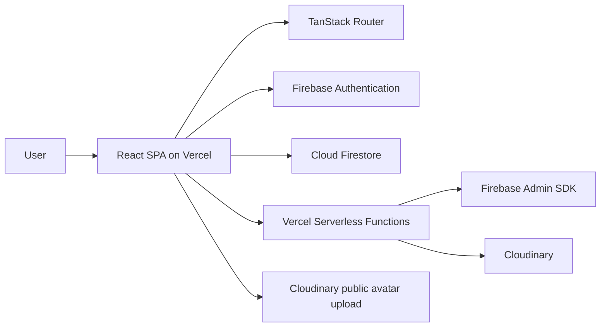
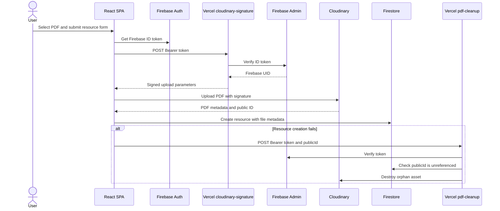
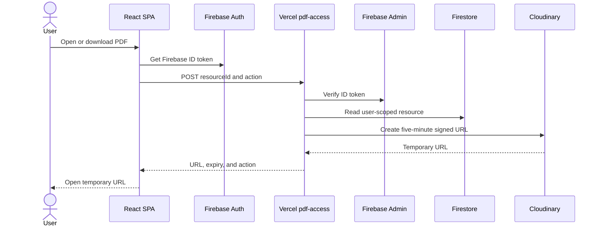
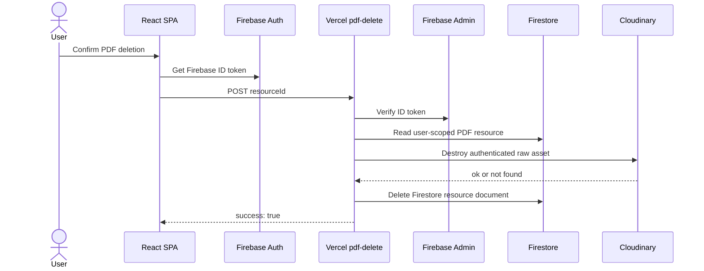

# Organex Technical Architecture

Organex is a personal digital learning library for saving, organizing, searching, and securely accessing learning resources such as links, articles, videos, notes, and PDFs. The application is implemented as a React single-page application with Firebase data services, Cloudinary asset storage, and a small set of privileged Vercel Serverless Functions.

## System Overview

The system is composed of a browser-based React SPA and managed platform services:

- **React 19** renders the application interface and coordinates client-side data operations.
- **Vite 7** provides the frontend development server and production build pipeline.
- **TanStack Router** provides file-based client-side routing and generates the route tree.
- **Firebase Authentication** manages email/password accounts and the authenticated session.
- **Cloud Firestore** stores user profiles and user-owned resource, collection, and tag metadata.
- **Cloudinary** stores uploaded avatars and private PDF assets.
- **Vercel Serverless Functions** perform privileged Firebase Admin and Cloudinary operations for PDFs.
- **Vercel Hosting** serves the built SPA and deploys the functions under `api/`.

There is no continuously running application backend. Server-side privileged operations are implemented as Vercel Serverless Functions. The frontend communicates directly with Firebase client services for authenticated application data and calls the functions only for the protected Cloudinary/PDF operations.

### Architecture Diagram



The frontend is built with Vite and deployed as a static SPA. `vercel.json` rewrites incoming application paths to `frontend/index.html` so client-side routes can resolve correctly.

## Frontend Architecture

The frontend lives in `frontend/` and is bootstrapped by `frontend/src/main.jsx`:

1. Firebase is initialized through `frontend/src/firebase/config.js`.
2. `AuthProvider` subscribes to Firebase `onAuthStateChanged`.
3. TanStack Router renders the generated route tree.
4. The root route provides the shared Header, Footer, toast provider, and router outlet.

The main code boundaries are:

| Area            | Location                          | Responsibility                                                                                    |
| --------------- | --------------------------------- | ------------------------------------------------------------------------------------------------- |
| Routes          | `frontend/src/routes/`            | Page-level composition, route parameters, loading/error states, and user interactions             |
| Components      | `frontend/src/components/`        | Reusable UI, authentication guards, resource cards, and shadcn/ui primitives                      |
| Hooks           | `frontend/src/hooks/`             | Shared React state integrations, including authentication and mobile behavior                     |
| Library modules | `frontend/src/lib/`               | Firebase Auth, Firestore services, Cloudinary/PDF client calls, validation, and pure search logic |
| Firebase client | `frontend/src/firebase/config.js` | Firebase app, Auth, Firestore, and optional Analytics initialization                              |

Forms use React Hook Form with Zod schemas in `frontend/src/lib/validations.js`. Sonner provides toast notifications. Tailwind CSS v4 and shadcn/ui provide the responsive light/dark visual system. `ResourceCard` is reused by Library, Search, Favorites, and collection/tag detail views rather than duplicating resource markup.

## Routing

TanStack Router uses the files in `frontend/src/routes/` to generate `frontend/src/routeTree.gen.js`. The important implemented routes are:

| Route              | Purpose                                                                 | Access            |
| ------------------ | ----------------------------------------------------------------------- | ----------------- |
| `/`                | Guest landing page or authenticated home dashboard                      | Public/auth-aware |
| `/login`           | Email/password sign-in and password reset request                       | Public            |
| `/signup`          | Account creation                                                        | Public            |
| `/onboarding`      | First-use onboarding walkthrough                                        | Protected         |
| `/library`         | Resource library with type, tag, collection, starred, and sort controls | Protected         |
| `/favorites`       | View of resources where `isStarred` is true                             | Protected         |
| `/search`          | Client-side search and combined filters                                 | Protected         |
| `/collections`     | Collection list and management                                          | Protected         |
| `/collections/$id` | Collection detail and referenced resources                              | Protected         |
| `/tags`            | Tag list and management                                                 | Protected         |
| `/tags/$id`        | Tag detail and referenced resources                                     | Protected         |
| `/resources/new`   | Resource creation, including PDF upload                                 | Protected         |
| `/resources/$id`   | Resource detail, editing, starring, PDF access, and deletion            | Protected         |
| `/profile`         | Profile details, avatar upload, and password reset request              | Protected         |

`ProtectedRoute` waits for Firebase session restoration, redirects unauthenticated users to `/login`, and renders protected content only when a user exists. Email verification is not currently implemented.

## Authentication

Firebase Authentication is the source of truth for account identity and sessions.

- **Sign up:** `frontend/src/lib/auth.js` calls `createUserWithEmailAndPassword`, updates the Firebase display name, and creates the initial Firestore profile document.
- **Login:** `signInWithEmailAndPassword` restores the authenticated Firebase user and routes to the application.
- **Logout:** the shared `signOut` helper calls Firebase `signOut`.
- **Session restoration:** `AuthProvider` listens to `onAuthStateChanged` and exposes `{ user, loading }` through `useAuth()`.
- **Password reset:** the login page and profile page call `sendPasswordResetEmail` through the `resetPassword` helper.
- **Profile updates:** Firebase Auth profile data and the Firestore profile document are updated together by the profile service.

There is no current email-verification gate, change-password flow, or delete-account flow. Firebase UID is the ownership boundary for Firestore data and for the user-scoped Cloudinary PDF path.

## Firestore Data Model

All application data is stored below the authenticated user path:

```text
users/{uid}
|-- resources/{resourceId}
|-- collections/{collectionId}
`-- tags/{tagId}
```

### User Profile: `users/{uid}`

The sign-up flow creates these fields:

| Field                 | Description                             |
| --------------------- | --------------------------------------- |
| `displayName`         | User's display name                     |
| `avatarUrl`           | Cloudinary avatar URL, initially empty  |
| `onboardingCompleted` | Whether onboarding was completed        |
| `preferences`         | User preference object, initially empty |
| `createdAt`           | Firestore server timestamp              |
| `updatedAt`           | Added when profile data changes         |

### Resource: `users/{uid}/resources/{resourceId}`

Resources are created by `addResource()` and returned by `listResources()` in `createdAt` descending order.

| Field           | Description                                                    |
| --------------- | -------------------------------------------------------------- |
| `title`         | Required resource title                                        |
| `description`   | Optional description                                           |
| `resourceType`  | One of `link`, `article`, `video`, `note`, `pdf`, or `other`   |
| `url`           | Original URL for non-PDF resources; empty for PDFs             |
| `sourceDomain`  | URL hostname for non-PDF resources; empty for PDFs             |
| `personalNotes` | Optional user notes, supported during update                   |
| `isStarred`     | Boolean used for starring and Favorites                        |
| `tagIds`        | Array of referenced tag document IDs                           |
| `collectionIds` | Array of referenced collection document IDs                    |
| `thumbnailUrl`  | Reserved resource thumbnail field, currently initialized empty |
| `file`          | PDF metadata object, or `null` for non-PDF resources           |
| `createdAt`     | Firestore server timestamp                                     |
| `updatedAt`     | Firestore server timestamp                                     |

For a PDF, `file` contains `publicId`, `secureUrl`, `originalFilename`, `format`, `bytes`, `resourceType`, and `deliveryType`. The secure access functions validate these values before issuing access or deletion operations.

### Collection: `users/{uid}/collections/{collectionId}`

Collections contain:

- `name`
- `description` (created as an empty string)
- `color`
- `createdAt`

Collections are listed newest first. Resources reference them with IDs in `collectionIds`.

### Tag: `users/{uid}/tags/{tagId}`

Tags contain:

- `name`
- `color`
- `createdAt`

Tags are listed alphabetically by name. Resources reference them with IDs in `tagIds`.

## Resource Types

The validation module supports these resource types:

```text
link, article, video, note, pdf, other
```

Non-PDF resources require a valid URL. Their source domain is derived from the URL and stored in `sourceDomain`. Articles, videos, notes, links, and other resources share the same metadata model; the type controls the UI label and validation behavior.

PDF resources use an uploaded file instead of a URL. The creation UI accepts PDF files up to 10 MB, stores the returned Cloudinary metadata in `file`, and sets `url` and `sourceDomain` to empty values.

`resourceType` is immutable after creation:

- The resource detail form displays the type but does not allow changing it.
- `updateResource()` preserves the existing type from the detail route.
- `firestore.rules` rejects updates where `resourceType` is an affected field in user subcollections.

## Collections and Tags

Resources store relationships as arrays of document IDs rather than embedding collection or tag objects. Detail routes resolve those IDs through existing services:

- `listResourcesByCollection(collectionId)` queries resources with `collectionIds` containing the collection ID.
- `listResourcesByTag(tagId)` queries resources with `tagIds` containing the tag ID.
- `/collections/$id` and `/tags/$id` display the matching resources using `ResourceCard`.

Deleting a collection or tag performs a bounded cleanup batch:

1. Find resources referencing the ID.
2. Remove only that ID from each matching resource with `arrayRemove`.
3. Delete the collection or tag document.
4. Commit the batch.

The resource documents themselves are not deleted. Deletion is rejected when more than 499 resources reference the entity, keeping the operation within the Firestore batch limit.

## Search Architecture

Search is client-side. The Search route loads resources, tags, and collections through `listResources()`, `listTags()`, and `listCollections()`. The pure filtering logic is in `frontend/src/lib/search.js` as `filterResources()`.

The helper builds lookup maps for tag and collection names and matches case-insensitively against:

- `title`
- `description`
- `personalNotes`
- `url`
- `sourceDomain`
- `file.originalFilename`
- Names of linked tags
- Names of linked collections

The active filters are combined with the query:

- Resource type
- Starred only
- Collection ID
- Tag ID

An empty query matches all resources subject to the active filters. No Algolia, Elasticsearch, external full-text search service, or search backend is used. Loading the user's current library and filtering it in memory is appropriate for the current project scale and keeps the search implementation simple.

## Favorites

Favorites is a view over the existing resource field:

```text
resource.isStarred === true
```

There is no separate Favorites collection or document type. The resource detail page and `ResourceCard` call `toggleStar()`, which updates `isStarred` on the resource. The Favorites route reuses `ResourceCard`; unstar actions update local state optimistically and remove the resource from the derived Favorites list. A failed update rolls the local state back and shows an error toast.

## Secure PDF Architecture

PDF assets are private Cloudinary assets. The browser never receives the Cloudinary API secret. The client sends the authenticated Firebase ID token to the relevant Vercel function, and the function verifies it with Firebase Admin before performing privileged work.

### Upload

1. The authenticated resource form validates that a selected file is a PDF and is no larger than 10 MB.
2. The browser calls `POST /api/cloudinary-signature` with a Firebase Bearer token.
3. The function verifies the token and returns a Cloudinary signature, timestamp, user-scoped folder, authenticated upload settings, public API key, cloud name, and upload URL.
4. The browser uploads the file directly to Cloudinary using the signed form fields.
5. The browser stores the returned file metadata in Firestore through `addResource()`.
6. If Firestore resource creation fails after the upload, the client calls the cleanup function for the uploaded public ID.

### Access, Open, and Download

1. The resource detail page calls `getSecurePdfAccessUrl(resourceId, action)` with `view` or `download`.
2. The client sends `POST /api/pdf-access` with the Firebase Bearer token and `{ resourceId, action }`.
3. The function verifies the token, reads the resource under the authenticated UID, and validates that it is a secure PDF whose Cloudinary public ID is user-scoped and configured as authenticated raw PDF delivery.
4. Cloudinary generates a signed URL that expires after five minutes. The function returns the URL, expiry timestamp, and action.
5. The browser opens the temporary URL in a new window. Download requests set Cloudinary's attachment option.

### Delete

1. The resource detail page calls `deleteSecurePdfResource(resourceId)` for PDF resources.
2. The client sends `POST /api/pdf-delete` with `{ resourceId }` and a Firebase Bearer token.
3. The function resolves the resource below the authenticated UID and validates the secure PDF metadata and user-scoped public ID.
4. The function destroys the authenticated raw asset in Cloudinary.
5. After a successful or already-missing Cloudinary deletion, it deletes the Firestore resource document.

### Orphan Cleanup

`POST /api/pdf-cleanup` accepts a `publicId` after Firebase token verification. The function requires a user-scoped `users/{uid}/resources/` prefix, rejects traversal-like values, checks Firestore for an existing resource with that `file.publicId`, and returns a conflict instead of deleting an already-linked asset. Unreferenced assets are destroyed in Cloudinary.

### PDF Sequence Diagrams

#### Secure PDF Upload



#### Secure PDF Access and Download



#### Secure PDF Delete



## Cloudinary

Cloudinary configuration is split by trust boundary:

- **Frontend-public configuration:** `VITE_CLOUDINARY_CLOUD_NAME` and `VITE_CLOUDINARY_UPLOAD_PRESET` are used by `profile.js` for unsigned avatar image uploads. Values exposed through `VITE_*` are bundled into the browser and are not server secrets.
- **Server-only configuration:** `CLOUDINARY_CLOUD_NAME`, `CLOUDINARY_API_KEY`, and `CLOUDINARY_API_SECRET` are used by the Vercel functions. The API secret is used to sign PDF upload/access operations and is never sent to the frontend.

The application uses Cloudinary for avatars and private PDFs. It does not use Firebase Storage for file storage.

## Vercel Serverless Functions

All functions expect a Firebase ID token in an `Authorization: Bearer <token>` header. They are CommonJS handlers deployed from the root `api/` directory.

| Function                      | Purpose                                               | Inputs                                                                        | Output                                                                                                            | External systems                                 |
| ----------------------------- | ----------------------------------------------------- | ----------------------------------------------------------------------------- | ----------------------------------------------------------------------------------------------------------------- | ------------------------------------------------ |
| `api/cloudinary-signature.js` | Create signed PDF upload parameters                   | `POST`, Bearer token; no request body required                                | `signature`, `timestamp`, user-scoped `folder`, authenticated upload settings, `apiKey`, `cloudName`, `uploadUrl` | Firebase Admin Auth, Cloudinary                  |
| `api/pdf-access.js`           | Issue a temporary PDF view/download URL               | `POST`, Bearer token, `resourceId`, optional `action` of `view` or `download` | `url`, `expiresAt`, `action`                                                                                      | Firebase Admin Auth, Admin Firestore, Cloudinary |
| `api/pdf-delete.js`           | Delete an owned secure PDF and its Firestore resource | `POST`, Bearer token, `resourceId`                                            | `{ success: true }`                                                                                               | Firebase Admin Auth, Admin Firestore, Cloudinary |
| `api/pdf-cleanup.js`          | Remove an uploaded but unreferenced PDF               | `POST`, Bearer token, `publicId`                                              | `{ success: true }`                                                                                               | Firebase Admin Auth, Admin Firestore, Cloudinary |

The functions reject unsupported HTTP methods, malformed authorization, invalid identifiers, invalid PDF metadata, and ownership/path mismatches. Error responses use status codes such as 400, 401, 404, 409, 502, and 500 depending on the failure.

## Firestore Security Rules

`firestore.rules` defines the user ownership model:

- A request is owned when `request.auth != null` and `request.auth.uid` equals the `{userId}` path segment.
- The profile document at `users/{userId}` allows read/write only to that owner.
- User-owned subcollections allow owner reads, creates, and deletes.
- Owner updates are allowed only when the update does not affect `resourceType`.

Firestore Rules protect Firestore documents; they do not protect Cloudinary directly. PDF functions add their own Firebase ID token, UID path, resource ownership, and secure metadata validation before using Cloudinary.

## Environment Configuration

`.env.example` documents the variables currently referenced by the codebase without including values.

### Frontend and Public Configuration

- `VITE_FIREBASE_API_KEY`
- `VITE_FIREBASE_AUTH_DOMAIN`
- `VITE_FIREBASE_PROJECT_ID`
- `VITE_FIREBASE_STORAGE_BUCKET`
- `VITE_FIREBASE_MSG_SENDER_ID`
- `VITE_FIREBASE_APP_ID`
- `VITE_FIREBASE_MEASUREMENT_ID`
- `VITE_CLOUDINARY_CLOUD_NAME`
- `VITE_CLOUDINARY_UPLOAD_PRESET`

`VITE_*` values are bundled into the frontend and must not be treated as server secrets.

### Server-only Configuration

- `FIREBASE_PROJECT_ID`
- `FIREBASE_CLIENT_EMAIL`
- `FIREBASE_PRIVATE_KEY`
- `CLOUDINARY_CLOUD_NAME`
- `CLOUDINARY_API_KEY`
- `CLOUDINARY_API_SECRET`

`FIREBASE_PRIVATE_KEY` may contain escaped newline sequences when supplied through an environment variable. These credentials belong in Vercel's server-side environment configuration, not in browser code.

### Local Configuration

- `PORT` optionally changes the Vite development server port from its default of `3000`.
- `.env.local` is intended for local values and is ignored by Git.

## Testing Architecture

The root workspace runs the frontend Vitest suite with `npm test`. Tests are deterministic and use mocked Firebase/Firestore and browser APIs; they do not call production Firebase, Cloudinary, Vercel Functions, or live network services.

Current test files are under `frontend/src/lib/`:

- `resources.test.js`: resource listing/creation/deletion, star toggling, resource guards, and secure PDF client request guards.
- `collections.test.js`: collection lookup and bounded reference cleanup.
- `tags.test.js`: tag lookup and bounded reference cleanup.
- `search.test.js`: pure search matching, filters, Favorites semantics, stale IDs, and no-match behavior.

React Testing Library is installed for component testing, but the current automated coverage is primarily service and pure-logic testing. There is no end-to-end test suite.

## Deployment Architecture

The expected deployment path is:

```text
GitHub main
    -> Vercel deployment
    -> npm install
    -> npm run build
    -> frontend/dist
```

`vercel.json` defines:

- Install command: `npm install`
- Build command: `npm run build`
- Development command: `npm run dev`
- Output directory: `frontend/dist`
- SPA rewrite from `/(.*)` to `/index.html`

Vercel deploys the functions from `/api` alongside the frontend. Firestore Rules deployment is separate from the frontend deployment and is configured through `firebase.json` and `firestore.rules`.

## Security Decisions

Current security-relevant decisions include:

- Firebase UID is the ownership boundary for Firestore data and user-scoped PDF paths.
- Firestore Rules restrict user data access to the authenticated owner.
- Vercel Functions validate Firebase ID tokens with Firebase Admin.
- Firebase Admin and Cloudinary API secrets remain server-side.
- PDFs use private authenticated Cloudinary delivery and temporary signed URLs.
- `resourceType` is immutable after resource creation.
- Collection/tag deletion removes references without deleting resources and enforces the Firestore batch limit.
- Orphan PDF cleanup checks that an asset is not already referenced before deletion.
- `.env` files, local environment files, and credentials are excluded from Git.

These controls reduce unauthorized access risks but do not constitute an absolute security guarantee; deployment configuration and provider settings must also be maintained correctly.

## Design Decisions

- **Firestore instead of a persistent custom backend:** the application uses Firebase client services for user-scoped CRUD and avoids operating a continuously running API server.
- **Serverless functions for privileged PDF operations:** token verification, Cloudinary signing, ownership validation, temporary URL creation, and deletion require server-side credentials.
- **Client-side Search:** the current library size and data model make in-memory filtering simpler than introducing a separate search index or backend.
- **ID arrays for relationships:** resources store `tagIds` and `collectionIds`, allowing direct membership queries and explicit cleanup when an entity is deleted.
- **No separate Favorites table:** Favorites is derived from `isStarred` on resources.
- **Reusable ResourceCard:** Library, Search, Favorites, and detail views share one resource presentation and star interaction.
- **File-based routing:** route files provide a direct mapping between application pages and TanStack Router's generated route tree.

## Known Limitations

- Search has no external full-text index and is limited by the amount of data loaded into the browser.
- Automated tests are primarily service and pure-logic tests rather than UI or end-to-end tests.
- Live Firebase, Cloudinary, and Vercel integration is not automated in the test suite.
- There is no Recently Viewed feature.
- Account management is limited to the currently implemented sign-in, sign-up, logout, profile, and password-reset flows.

## Future Improvements

Potential future work includes:

- Recently Viewed resources
- Broader integration and end-to-end coverage
- Search indexing for substantially larger libraries
- Bundle and code-splitting optimization
- Richer usage analytics
